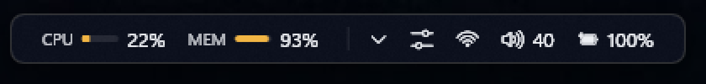
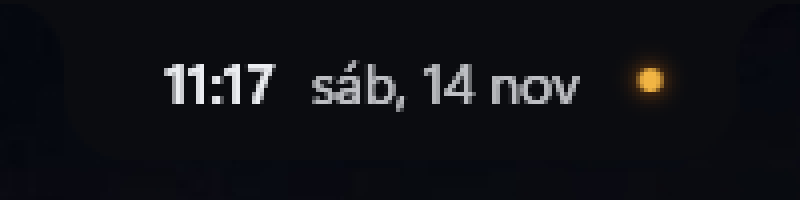
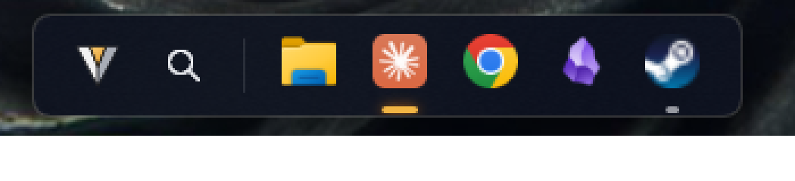

# Pesquisa: visual mais premium para a barra, o notch e a doca

14/11/2026. Esta é só uma pesquisa: nenhum código de produto foi alterado. O Gustavo escolhe o que entra.

Foram três fontes:
- **Código:** `Tema/Tokens.xaml`, `Tema/ServicoAparencia.cs`, `Barra/VidroIlha.cs`, `Barra/JanelaIlha.cs`, `Barra/JanelaFundoBarra.cs`, `Barra/JanelaNotch.cs`, `Barra/Pilula.cs`, `Core/Aparencia/ResolverAparencia.cs`, `Core/Formas/ResolverFormas.cs`, `Ui/Barra/FormaNotch.cs`.
- **Capturas da tela:** Vitral 0.17.1 instalado, monitor de 2560×1440 em escala de 100%, tema Vidro escuro, notch Grande, papel de parede escuro. Os pixels foram lidos um a um.
- **Referências da web:** citadas na seção 3.

## 1. Resumo

A suspeita sobre as bordas se confirma, mas o problema não é a borda que o Vitral desenha. A linha visível em volta das ilhas e da doca é **cinza neutro, opaca na prática, com o mesmo peso em cima e embaixo**. Pela cor medida, ela parece ser a borda que o próprio Windows 11 desenha em toda janela. A borda de vidro do Vitral, que era um gradiente com realce em cima, foi trocada por uma cor chapada no dicionário da aparência e ficou por baixo da linha do Windows.

Três outros pontos pesam no "não premium":

- O notch é **cinza muito escuro (`#0B0C10`), não preto**, e fica mais claro que o papel de parede em volta.
- As ilhas são **azul-marinho**, o notch é **grafite neutro**: são dois "pretos" diferentes lado a lado.
- O notch **quica tanto ao abrir quanto ao fechar**.

## 2. Diagnóstico do visual atual

### 2.1 Como as bordas são desenhadas hoje

| Onde | Quem desenha | Espessura | Cor e alfa (Vidro escuro) | Arquivo |
|---|---|---|---|---|
| Ilhas (mídia, status) | `Border` WPF da casca | 1 px nos 4 lados | `BordaVidro` → cor chapada `v.Borda` = branco a 10% (`#1AFFFFFF`) | `JanelaIlha.cs:38-41`, `VidroIlha.cs:65`, `ServicoAparencia.cs:101` |
| Ilhas, doca, painéis, miniaturas | **DWM do Windows 11** (linha de 1 px de toda janela com cantos arredondados) | 1 px | cinza neutro; medido **`#303235`** (48,50,53) sobre a ilha e **`#484A49`** sobre a doca | Não é desligada. `VidroIlha.cs:92` só usa `DWMWA_BORDER_COLOR = NONE` no modo "sem vidro" |
| Notch encaixado na borda (`presaNaBorda`) | `Border` WPF | 1 px nos lados e embaixo | igual às ilhas | `JanelaIlha.cs:46-51` |
| Notch vivo (`JanelaNotch`) | `Path` preenchido | **nenhuma** | — | `JanelaNotch.cs:205-214` |
| Fundo da barra única | `Border` WPF | 1 px | `BordaVidro` | `JanelaFundoBarra.cs:17` |
| Doca e painéis | `Border` WPF + DWM | 1 px | `BordaVidro` chapado + linha do DWM | `JanelaDoca.cs:37`, `JanelaPainel.cs:55` |
| Menus de contexto | `Border` WPF + `DropShadowEffect` (24 px de desfoque, opacidade 0,45) | 1 px | `BordaVidro` | `Estilos.xaml:389-390` |
| Pílulas "contorno" | `Border` WPF | 1 px | texto a 28% (`#47…`) | `Pilula.cs`, `ServicoAparencia.cs:118` |

**O gradiente que existe mas não aparece.** Em `Tokens.xaml` a `BordaVidro` é um gradiente vertical: `#24FFFFFF` (14%) no alto, caindo para `#14FFFFFF` (8%) a partir de 35% da altura. Esse é o filete especular que a especificação queria. Só que `ServicoAparencia.Preencher` redefine `BordaVidro` para doca, notch e ilhas como um `SolidColorBrush(v.Borda)`, branco a 10% ou preto a 8%. Resultado: o gradiente só vale na janela principal.

### 2.2 O que as capturas mostram

Ilha de status, ampliada 3×. O que se vê:
- A linha de contorno é cinza neutro (`#303235`), sobre um vidro azul-marinho (`#0E121F`) e um papel de parede quase preto (`#03050B`). Contra os dois ela é a coisa mais clara da forma, e é igual em cima e embaixo.
- Na coluna medida a sequência é 1 px cinza e depois o vidro, sem o branco a 10% do WPF ao lado. Por isso a linha deve ser a do Windows, por cima da do Vitral.
- Os cantos têm 8 px numa altura de 30 px: retângulo arredondado, não cápsula. A casca nasce com raio 15 em `JanelaIlha.cs:37`, mas `VidroIlha.Atualizar` sobrescreve com `RaioPx = 8`, e o DWM só arredonda com 8 px ou 4 px.

Notch, ampliado 4×. O que se vê:
- O corpo é `#0B0C10` chapado, 40 px de altura (tamanho Grande).
- O papel de parede logo abaixo é `#070A11`, e nas laterais é `#03050B`. O notch fica **mais claro** que o fundo: lê-se como uma caixa grafite, não como um recorte preto na tela.
- Não tem borda nem sombra.
- O ponto âmbar tem brilho (`DropShadowEffect` de 8 px), o que está bom.

Doca, ampliada 3×. O que se vê:
- Sobre um papel de parede claro (mármore), o acrílico sai quase opaco, `#111622`. O "vidro" não se lê como vidro, por causa do tingimento de 72% de `#0A0F20`.
- A linha do Windows (`#484A49`) contorna tudo por igual.
- Não há sombra: a doca parece colada, não flutuando.

### 2.3 O que provavelmente soa "não premium"

1. **Linha cinza, opaca e uniforme.** As referências premium usam borda ausente (Dynamic Island, notches do Mac) ou um filete de 6–9% de alfa com realce em cima (Fluent). O Vitral tem uma linha de cerca de 19% de luminância, neutra sobre um vidro azulado, igual nos quatro lados. É o contorno típico de "janela do Windows", não de objeto de vidro.
2. **Notch grafite em vez de preto.** O efeito da Dynamic Island depende do preto puro, que some na moldura e no fundo escuro. Um `#0B0C10` sobre papel de parede escuro vira um retângulo cinza.
3. **Dois pretos.** Ilhas e doca são azul-marinho (`#0A0F20` a 72%); o notch é grafite (`#0B0C10`). Lado a lado, parecem de dois apps.
4. **Linguagem de cantos misturada:** ilhas e doca 8 px, notch 16/22/24 px, pílulas 14 px (cápsula), menus 12 px, painéis 8 px. A HIG da Apple pede raios concêntricos. O Fluent usa 8 px para superfícies e 4 px para o que fica dentro delas.
5. **Movimento que quica ao fechar.** O corpo do notch anima largura, altura e raio com `BackEase` (amplitude 0,35, 320 ms) na abertura **e** no fechamento (`JanelaNotch.cs:651`). O Boring Notch abre com uma leve sobra e fecha sem quicar.
6. **Vidro que não parece vidro.** Sobre papel de parede claro, o tingimento de 72% apaga o desfoque. Sobre papel de parede escuro, a linha cinza é o que mais aparece.

## 3. Referências

### 3.1 Dynamic Island (iPhone)

Fonte: [HIG – Live Activities](https://developer.apple.com/design/human-interface-guidelines/live-activities).

- **Fundo:** preto opaco, que se funde com o recorte da câmera.
- **Borda:** só em contexto escuro há uma *key line* finíssima em volta, que o app pode tingir conforme o conteúdo. A HIG não dá espessura nem alfa.
- **Sombra e vidro:** nenhum dos dois.
- **Cantos:** cápsula, com 36,67 pt de altura na forma compacta. O conteúdo fica recuado com margens concêntricas ao raio, e nada encosta na borda.
- **Texto:** cores vivas sobre o preto.
- **Animação:** mola, interrompível. A Apple não publica os parâmetros. Para exemplos de expansão, ver [Infinum](https://infinum.com/?p=28092).

**Copiar:** preto puro, nenhuma borda (no máximo uma *key line* quase invisível) e raios concêntricos.

### 3.2 Notches do macOS: Boring Notch, NotchNook, Alcove

Fonte: código do [Boring Notch](https://github.com/TheBoredTeam/boring.notch), arquivos `ContentView.swift`, `NotchShape.swift` e `sizing/matters.swift` (lidos e conferidos).

- **Fundo e borda:** `.black` sólido, sem contorno. Um retângulo preto de 1 pt no topo cobre a costura com a borda da tela. O Vitral já faz o mesmo com `_topo` e a `Sobra`.
- **Cantos:** raio de cima côncavo (6 px fechado, 19 px aberto), que faz o notch "escorrer" da borda, e raio de baixo de 14 px fechado e 24 px aberto. O raio é animado junto com o tamanho.
- **Sombra:** só com o notch aberto ou com o mouse em cima. É preta, opacidade 0,7, raio 4–6, e a janela tem 20 pt de folga para a sombra não ser cortada.
- **Mola:** abrir `spring(response 0,42, damping 0,8)`, com leve sobra; fechar `spring(0,45, 1,0)`, sem sobra. O conteúdo entra com escala e opacidade em 0,35 s.

**NotchNook e Alcove:** só há páginas de marketing e resenhas ([lo.cafe/notchnook](https://lo.cafe/notchnook), [MacStories](https://www.macstories.net/reviews/notchnook-and-mediamate-two-apps-to-add-a-dynamic-island-to-the-mac/)). Delas só sai que, em monitor externo sem notch, o NotchNook vira uma ilha flutuante. Não há valores verificáveis.

**Copiar:** a mola assimétrica, a sombra só quando aberto e o preto sólido sem borda.

### 3.3 Barra de menus do macOS

- **Altura:** 24 pt ([HIG – The menu bar](https://developer.apple.com/design/human-interface-guidelines/the-menu-bar)).
- **Big Sur a Sequoia:** a barra é translúcida com *vibrancy* ([Pixel Envy](https://pxlnv.com/blog/sidebar-translucency/)).
- **Tahoe 26 (Liquid Glass):** a barra fica **sem fundo** por padrão, e o texto alterna entre claro e escuro conforme o que há atrás. A reação foi mista, e a Apple acrescentou a opção "Mostrar fundo da barra de menus" ([Six Colors](https://sixcolors.com/post/2025/09/macos-26-tahoe-review-power-under-glass/)).
- **Liquid Glass em geral:** só na camada de controles, com parcimônia, e com uma variante escurecida quando a legibilidade falha ([HIG – Materials](https://developer.apple.com/design/human-interface-guidelines/materials)). O brilho especular na borda não é documentado pela Apple, só por terceiros.

**Copiar:** a ideia de que o modo "barra única" pode ficar quase sem fundo, e que borda e fundo devem ser discretos ao ponto de sumir.

### 3.4 Windows 11 Fluent: Mica, Acrylic, elevação

Fontes: [Materials](https://learn.microsoft.com/en-us/windows/apps/design/signature-experiences/materials), [Acrylic](https://learn.microsoft.com/en-us/windows/apps/design/style/acrylic), [Geometry](https://learn.microsoft.com/en-us/windows/apps/design/signature-experiences/geometry), [Layering](https://learn.microsoft.com/en-us/windows/apps/design/signature-experiences/layering) e o [`Common_themeresources_any.xaml`](https://github.com/microsoft/microsoft-ui-xaml/blob/main/controls/dev/CommonStyles/Common_themeresources_any.xaml) do WinUI, conferido.

**Borda "que quase não se vê"** (`ControlElevationBorderBrush`):
- É um gradiente com `MappingMode="Absolute"` de `0,0` a `0,3`: só os 3 primeiros px variam.
- No tema escuro vai de `ControlStrokeColorSecondary` = `#18FFFFFF` (9%) no alto para `ControlStrokeColorDefault` = `#12FFFFFF` (7%) no resto.
- No tema claro o gradiente é invertido (`ScaleY=-1`): `#0F000000` (6%) em cima e `#29000000` (16%) embaixo, como uma sombra de contato.
- O separador `DividerStrokeColorDefault` é `#15FFFFFF`.

**Cantos:** 8 px para superfícies de topo (janelas, flyouts), 4 px para o que fica dentro delas, 0 px onde uma reta encosta em outra.

**Elevação:** sombra mais ampla e suave quanto mais alta a superfície (janela 128, flyout 32, card 8), sempre com stroke de 1 px. A Microsoft não publica os px da sombra.

**Texto (escuro):** primário 100%, secundário `#C5FFFFFF` (77%), terciário 53%.

**Acrílico:** só em superfícies transitórias. Vira cor sólida com a transparência desligada. Não se deve pôr painéis de acrílico lado a lado, porque aparece a costura.

**Copiar:** o gradiente de 3 px com 7–9% de alfa e o texto secundário a 77%.

### 3.5 Outras barras de Windows (Zebar, YASB, Windhawk, Seelen)

São estilizadas por CSS do usuário. Não há um padrão verificável, então não usei como referência.

## 4. Mudanças recomendadas, em ordem de impacto

### 1) Trocar a linha cinza por um realce interno de 1 px em gradiente

**Impacto:** alto. **Risco:** baixo a médio.

**Antes, um teste de 5 minutos para confirmar a causa:**
1. Num build local, chamar `DwmSetWindowAttribute(h, DWMWA_BORDER_COLOR, DWMWA_COLOR_NONE)` também no caminho com vidro de `VidroIlha.Atualizar`.
2. Ver se a linha `#303235` some.

Se sumir, a causa é a borda do Windows e vale seguir.

**O que fazer:**
- `src/Vitral.App/Barra/VidroIlha.cs`: desligar a borda do DWM sempre (`DwmCorNenhuma`), não só no "sem vidro". O bloco que restaura `DwmCorPadrao` ao sair da barra única passa a não ser necessário.
- `src/Vitral.App/Tema/ServicoAparencia.cs` (`Preencher`): `BordaVidro` deixa de ser `Pincel(v.Borda)` e vira um `LinearGradientBrush`. Dois desenhos possíveis:
  - **Igual ao Fluent:** `MappingMode="Absolute"`, de 0 a 3 px, indo de um realce a cerca de 9–12% para a base a cerca de 5–7%.
  - **Mais "vidro":** gradiente relativo de 14% no topo para 4% a 40% da altura e 2% embaixo.
  - No tema claro, inverter o sentido, como o WinUI faz: preto fraco em cima e mais forte embaixo.
- `src/Vitral.Core/Aparencia/ResolverAparencia.cs` (`Montar`): o cálculo de `borda` passa a dar duas cores, realce e base, em vez de uma. Pode ser um novo campo `BordaRealce` em `ValoresParte`.
- O `BordaVidro` de `Tokens.xaml` já é quase isso. Basta deixar a aparência gerar um gradiente equivalente em vez de achatá-lo.

**Riscos:**
- No tema Claro e no Cristal, sem a linha do Windows, a ilha pode perder a separação do fundo. O realce invertido (sombra de contato embaixo) é justamente para isso. Conferir os 7 temas.
- O atributo `DWMWA_BORDER_COLOR` só existe no Windows 11 22000 ou mais novo. É o mínimo do Vitral, mas vale manter a chamada tolerante a erro.
- A linha do Windows muda com o foco e com a cor de destaque quando "Mostrar cor de destaque nas bordas" está ligado. Desligá-la remove esse efeito, o que provavelmente é desejado.

### 2) Notch em preto puro, sem borda

**Impacto:** alto. **Risco:** baixo.

- `src/Vitral.Core/Aparencia/ResolverAparencia.cs`, em `Tema()`: o fundo do notch de Vidro escuro, Preto sólido e Automático (escuro) passa de `#0B0C10` para `#000000`. Grafite (`#1A1B1F`), Vidro colorido e Cristal ficam como estão, porque são escolhas de estilo.
- Opcional, no tema escuro: uma *key line* como a da Dynamic Island, com 1 px de branco a 6–8%, só nos lados e embaixo do `Path` e só com o notch aberto (aviso, pedido, resposta). Seria um `Stroke` no `_forma` em `JanelaNotch.cs`, com espessura animada de 0 a 1.

**Riscos:**
- Sobre papel de parede claro nada muda (preto continua preto).
- Sobre papel de parede escuro o notch "some" até abrir. Isso é o efeito desejado, mas o Gustavo pode querer ver o relógio destacado. O texto continua visível.

### 3) Mola assimétrica no notch: abre com sobra, fecha sem quicar

**Impacto:** médio a alto, no "sentir caro". **Risco:** baixo.

- `src/Vitral.App/Barra/JanelaNotch.cs` (`Ajustar` e `Animar`): escolher a curva pelo sentido.
  - Quando a área do corpo cresce: manter `CurvaMola` (BackEase 0,35). Pode até baixar para 0,25.
  - Quando encolhe: uma nova `CurvaFechar` (`CubicEase` ou `QuinticEase` EaseOut, cerca de 280 ms), sem sobra.
- `src/Vitral.App/Tema/Tokens.xaml`: novos tokens `CurvaFechar` e `DuracaoNotchFechar`.
- Os painéis já cruzam opacidade. Para imitar o Boring Notch, o conteúdo que entra pode ganhar uma escala leve de 0,96 para 1 (`RenderTransform`, sem mexer no layout).

**Riscos:** quase nenhum. Com "Efeitos de animação" do Windows desligado tudo continua instantâneo, porque passa por `Efeitos.Tempo`.

### 4) Um preto só: alinhar o tom das ilhas e da doca com o notch, e soltar um pouco o vidro

**Impacto:** médio. **Risco:** médio, por causa da legibilidade.

- `src/Vitral.Core/Aparencia/ResolverAparencia.cs`, `Tema()`, no caso Vidro escuro (o `_`): o tingimento das partes passa de `#0A0F20` a 72% para um neutro próximo do notch, por exemplo `#0B0C10` ou `#101114`, a cerca de 60%. Ilhas, doca e notch ficam da mesma família, e o vidro volta a deixar ver o papel de parede.
- Opcional: subir `TextoSecundario` de 62% para cerca de 72–77% (o Fluent usa 77%) no mesmo `Montar`, para compensar o vidro mais aberto. Os rótulos "CPU" e "MEM" hoje estão no limite.

**Riscos:**
- Sobre papel de parede muito claro e movimentado, 60% pode prejudicar o contraste do texto de 12 px. Testar com o papel de parede de mármore atual, que é bom caso de teste.
- Mudar o Vidro escuro muda o padrão de todos os perfis que não personalizam o fundo. Alternativa: um tema novo, "Vidro neutro", sem mexer no atual.

### 5) Sombra suave onde há flutuação: doca, painéis e notch aberto

**Impacto:** médio. **Risco:** médio.

- **Notch** (`JanelaNotch.cs`, que já usa `AllowsTransparency = true`): um `DropShadowEffect` no `_corpo` só quando o modo não é Normal nem Lembrete. Preto, opacidade de 0,5 a 0,7, `BlurRadius` de 16 a 24, `ShadowDepth` de 2 a 4, para baixo. A opacidade do efeito é animada com o corpo. É preciso folga na janela, já que `JanelaLargura` é `LarguraMaxCorpo + 2×Orelha`, sem margem, e a altura também para a sombra de baixo não ser cortada (`NotchMedidas` em `src/Vitral.Ui/Barra/FormaNotch.cs`). Isso pede revisão do teste de clique, porque a folga é transparente.
- **Doca e painéis:** usam acrílico por `SetWindowCompositionAttribute`, com `AllowsTransparency = false`. A sombra teria de vir do DWM (sombra de janela, que hoje não aparece) ou de uma janela-sombra separada atrás. A segunda opção é mais trabalhosa e tem risco de dessincronia ao mover. Sugiro deixar a doca para depois e começar pelo notch.

**Riscos:**
- Desempenho do efeito numa janela em camadas que muda de tamanho a cada quadro. Medir: WPF desenha o `DropShadowEffect` em GPU, mas a janela `AllowsTransparency` é composta por software.
- Folga transparente engolindo cliques: a raiz já não tem fundo, então o clique passa, mas vale testar.

### Não recomendado agora: transformar as ilhas em cápsula de verdade

Seria o que mais aproxima o visual da Dynamic Island: raio igual à metade da altura, 15 px nas ilhas de 30 px. Mas o DWM só arredonda com 8 px ou 4 px, e a decisão registrada no `VidroIlha` é que o único acrílico que segue desfocando com a janela inativa é o de janela **sem** camadas. Cápsula exigiria região de janela (`SetWindowRgn`, que deixa serrilhado) ou janela em camadas (que perde o acrílico). O custo e o risco são altos para o ganho. Se as mudanças 1 e 2 forem feitas, a mistura de raios incomoda bem menos.

## 5. Como conferir depois de mudar

Repetir as capturas desta pesquisa e medir os mesmos pontos:
- Topo: a coluna x=2300 atravessa a ilha de status; a coluna x=1280 atravessa o notch.
- Doca: a coluna x=1200.

**O que se espera ver:**
- **Borda das ilhas:** no lugar de `#303235` uniforme, o pixel de cima um pouco mais claro que o vidro e o de baixo quase igual ao vidro.
- **Notch:** pixels `#000000` sobre o papel de parede escuro.
- **Os 7 temas:** conferir um a um, nos dois modos do Windows, para garantir que o tema Claro e o Cristal não perderam a separação do fundo.
